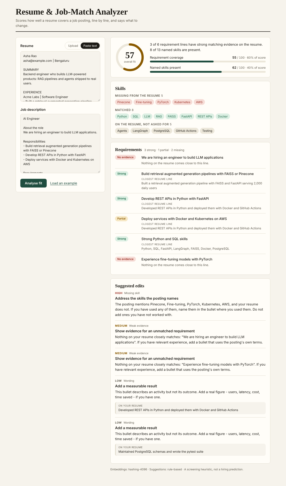
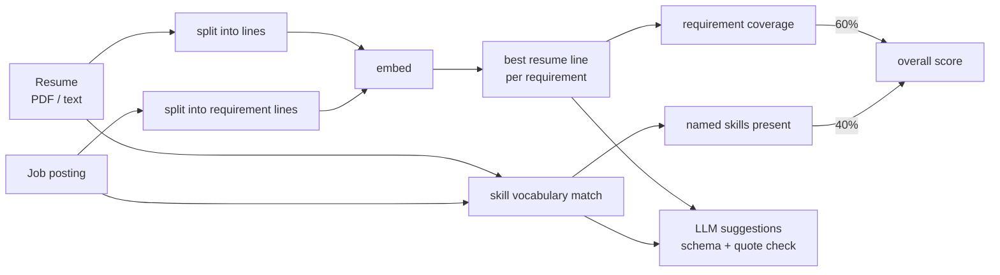

# AI Resume & Job-Match Analyzer

Paste a job posting and upload a resume. The API scores how well the resume covers the posting — requirement by requirement, with the resume line that counts as evidence — and returns structured suggestions for what to change.



**Stack:** FastAPI · NumPy embeddings pipeline · LLM suggestions validated with Pydantic · React + TypeScript (Vite)

## How the score is computed



- **Requirement coverage (60%).** Each line of the posting is compared with every line of the resume by cosine similarity. A requirement's score is its *best* match, and the component is the mean over requirements. Scoring coverage instead of whole-document similarity means a long resume gets no credit for bulk, and every number comes with the line that produced it.
- **Named skills (40%).** A curated vocabulary (about 80 skills with aliases — `k8s` → Kubernetes, `postgres` → PostgreSQL) is matched in both documents. Exact matching is explainable and cannot invent a skill. If the posting names no known skills this component is dropped rather than scored as zero.

The weights and thresholds are constants at the top of [`scoring.py`](backend/app/scoring.py). The result is a screening heuristic, not a prediction of a hiring outcome.

## Suggestions that cannot make things up

The LLM is sent both documents **and the gap analysis**, so its advice is tied to the same gaps the score reports. Its reply is not trusted:

1. It must parse into the `SuggestionSet` schema (category, priority, title, detail, optional excerpt + rewrite). A schema violation gets one repair turn that includes the validation error.
2. Any `resume_excerpt` must appear in the resume (whitespace- and case-insensitive). A quote that is not there is dropped, along with the rewrite built on it.
3. The system prompt forbids inventing experience, tools or metrics, and tells the model to treat both documents as data.
4. If the model is unavailable or still invalid after the repair turn, deterministic rule-based suggestions are returned instead, and `meta.suggestions_by` says which path produced them.

## Run it

```bash
# API
cd backend
pip install -e ".[dev]"
pytest                                # 41 tests, no network
uvicorn app.main:app --reload         # http://localhost:8000/docs

# UI (second terminal)
cd frontend
npm install
npm run dev                           # http://localhost:5173, proxies /api to :8000
```

One container, with the API serving the built UI:

```bash
docker build -t resume-analyzer .
docker run -p 8000:8000 --env-file .env resume-analyzer
```

Everything works with no keys: scoring uses an offline lexical embedder and suggestions are rule-based. Copy `.env.example` to `.env` to enable a real embedding model (`EMBEDDING_MODEL`) and LLM suggestions (`LLM_MODEL` + `ANTHROPIC_API_KEY` or `OPENAI_API_KEY`; `OPENAI_BASE_URL` accepts any OpenAI-compatible endpoint).

## API

`POST /api/analyze` — multipart form

| Field | Notes |
|---|---|
| `job_description` | required |
| `resume_file` | PDF, `.txt` or `.md`, up to 5 MB — or — |
| `resume_text` | pasted text |

```jsonc
{
  "score": { "overall": 57, "semantic": 55, "skills": 62, "weights": { "semantic": 0.6, "skills": 0.4 } },
  "skills": { "matched": ["Python", "SQL", "..."], "missing": ["Pinecone", "Kubernetes", "..."], "extra": ["..."], "coverage": 0.615 },
  "requirements": [
    { "requirement": "Develop REST APIs in Python with FastAPI", "score": 1.0, "status": "strong",
      "evidence": "Developed REST APIs in Python and deployed them with Docker and GitHub Actions" }
  ],
  "summary": "3 of 6 requirement lines have strong matching evidence on the resume. ...",
  "suggestions": [
    { "category": "missing_skill", "priority": "high", "title": "...", "detail": "...", "resume_excerpt": null, "rewrite": null }
  ],
  "meta": { "embedder": "hashing-4096", "suggestions_by": "rules", "resume_chars": 492 }
}
```

Invalid input returns `422` with a readable `detail` (scanned PDF with no text, unsupported file type, document too short).

## Tests

| File | Covers |
|---|---|
| `test_parsing_and_skills.py` | PDF extraction (a PDF is generated byte-by-byte in the test), bad uploads, re-joining wrapped PDF lines, bullet glyph clean-up, skill aliases, false-positive guards (`go to market`, `rest of`, `JavaScript` ≠ `Java`) |
| `test_scoring.py` | Evidence matching, heading filtering, the weighted sum, no-skills postings, a matching resume vs an unrelated one, calibration, embedding batch ordering |
| `test_suggestions.py` | Schema validation, fabricated quote removal, repair turn, fallbacks, rule-based content |
| `test_api.py` | Text and PDF requests, LLM path, error responses, dependency overrides |

## Limitations

- **The default embedder is lexical.** It hashes stemmed words and bigrams, so it rewards shared vocabulary and misses paraphrases ("built HTTP services" vs "developed REST APIs"). Set `EMBEDDING_MODEL` for semantic matching, and tune `EMBEDDING_CALIBRATION` for that model — the 0→1 mapping of cosine similarity is a heuristic and differs between models.
- Introductory sentences in a posting are scored as requirements if they are four or more words long.
- The skill vocabulary is technology-focused and finite; skills outside it are invisible to the skills component.
- Scanned (image-only) PDFs are rejected; there is no OCR.
- The LLM path is covered with a scripted fake model and mocked HTTP; it has not been run against a live provider in CI.

## License

MIT
